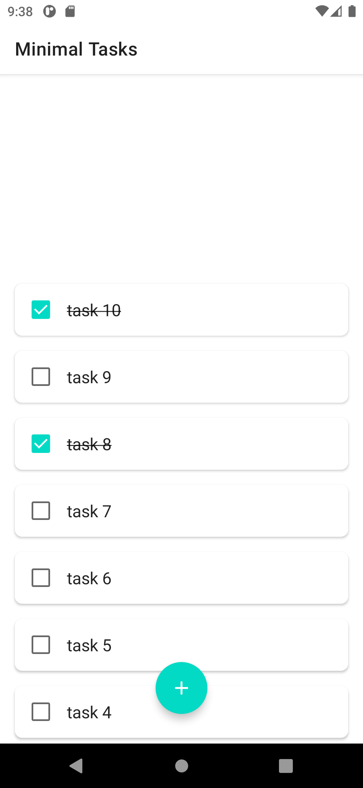
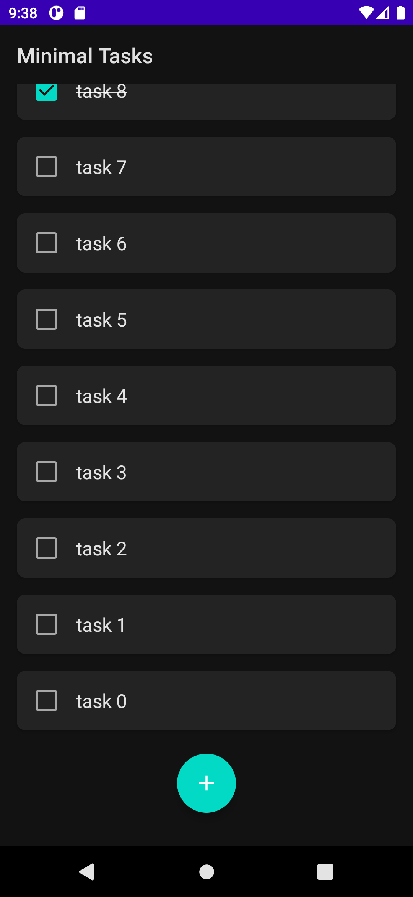

# Minimal Tasks

> **Archived.** A sample app from 2021–2023, moved here from GitLab. It isn't maintained.

**A to-do list, and a playground.** A minimal Android app for trying out new things: add tasks,
tick them off, remove them, in Jetpack Compose on a classic MVVM stack.

<p>
  
  
</p>

## Built with

- **UI:** Jetpack Compose (1.4) with Material, light and dark themes.
- **Architecture:** MVVM; a `ViewModel` over a repository, the tasks as a Kotlin `Flow`.
- **Data:** Room (2.5), one `tasks` table.
- **Dependency injection:** Hilt.
- **Tests:** a unit test for the view model (`app/src/test`).

Kotlin 1.8, compile SDK 33, minimum SDK 27 (Android 8.1).

## Running it

Open it in Android Studio and run the `app` configuration, or:

```sh
./gradlew installDebug   # with a device or emulator connected
./gradlew test           # the unit tests
```

It's set up for the Android Gradle Plugin and Kotlin of 2023, so a current Android Studio may
offer to upgrade them first.
